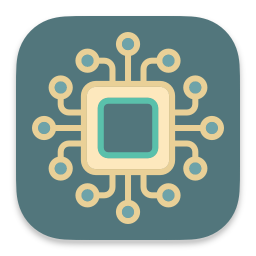
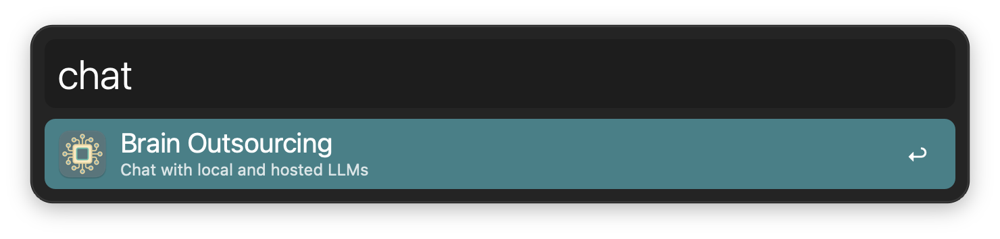
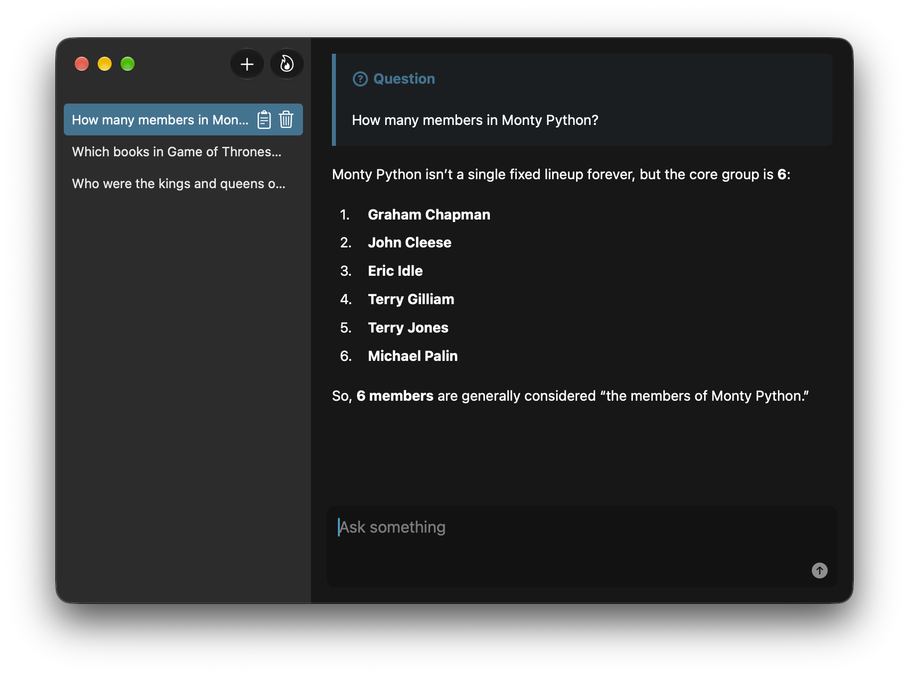

#  Brain Outsourcing Alfred Workflow

Chat with local and hosted LLMs

[⤓ Install on the Alfred Gallery](https://alfred.app/workflows/alfredapp/brain-outsourcing)

## Setup

Configure your desired LLM in the [Workflow’s Configuration](https://www.alfredapp.com/help/workflows/user-configuration/).

`API Endpoint` is the *chat completions* address specific to your service. Common values include:

| Provider         | Endpoint |
| ---------------- | -------- |
| OpenAI/ChatGPT   | https://api.openai.com/v1/chat/completions |
| Anthropic/Claude | https://api.anthropic.com/v1/chat/completions |
| Google/Gemini    | https://generativelanguage.googleapis.com/v1beta/openai/chat/completions |
| OpenRouter       | https://openrouter.ai/api/v1/chat/completions |
| Ollama           | http://localhost:11434/v1/chat/completions |
| LM Studio        | http://localhost:1234/v1/chat/completions |
| llama.cpp        | http://localhost:8080/v1/chat/completions |

`API Key` is the unique identifier provided by the service to access your account. For local LLMs this can generally be left empty and a dummy key is used.

`Model ID` is the *exact* name of the model, which depends on your provider. They tend to closely follow the model name. For example:

| Model Name       | Model ID |
| ---------------- | -------- |
| ChatGPT 5.4 Nano | `gpt-5.4-nano` |
| Claude Opus 5.5  | `claude-opus-5-5` |
| Llama 3.2 1B     | `llama3.2:1b` |

## Usage

Launch a UI to query an LLM via the `chat` keyword.

Configure the [Hotkey](https://www.alfredapp.com/help/workflows/triggers/hotkey/) for faster triggering.
